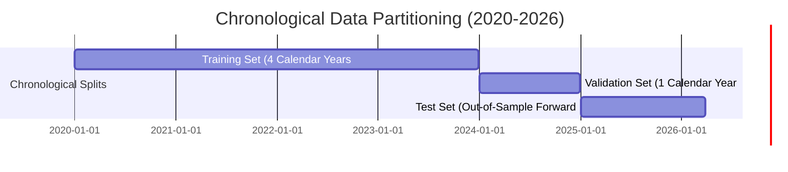
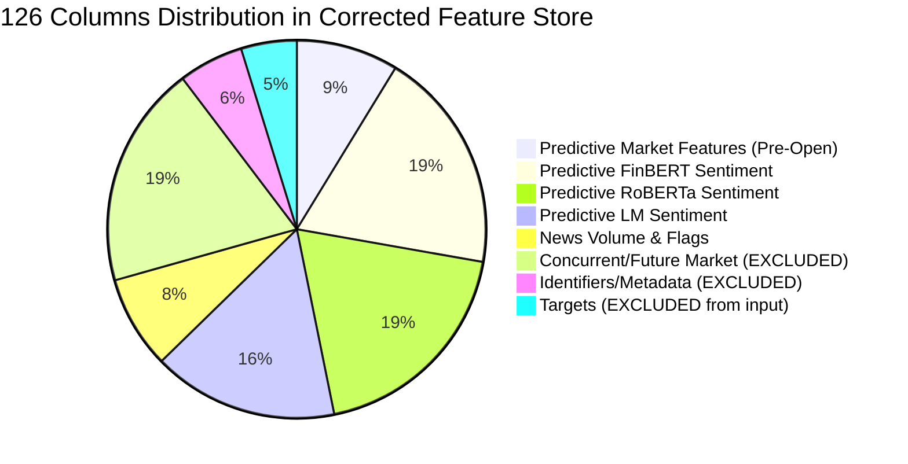

# Stage 4 — Phase 1: Experimental Design & Leakage Audit

**Project**: *Beyond Sentiment: A Comparative and Temporal Analysis of Financial News Sentiment for Short-Term Indian Stock Market Prediction*  
**Research Cohort**: 15 Continuous NSE Nifty 50 Equities (2020–2026)  
**Primary Dataset**: `data/final/final_sentiment_enhanced_dataset_corrected.parquet` (23,115 rows × 126 columns)  
**Date**: November 2026  
**Document**: Stage 4 Experimental Protocol, Chronological Splits, Baseline Benchmarks, Feature Partitions & Leakage Audit  
**Status**: Phase 1 Design Complete — Awaiting User Approval to Begin Phase 2 Model Training  

---

## 1. Primary Objectives and Prediction Targets

### 1.1 Primary Classification Objective
The core objective of Stage 4 is to determine whether domain-specific financial news sentiment representations (Loughran–McDonald, ProsusAI FinBERT, Financial RoBERTa) and their temporal decay structures provide incremental predictive power beyond leakage-free traditional market indicators.

- **Primary Classification Target**:
  $$\text{target\_same\_session\_dir\_o2c}_t = \mathbb{I}\left( \frac{\text{adj\_close}_t - \text{adj\_open}_t}{\text{adj\_open}_t} > 0 \right) \in \{0, 1\}$$
  - `Class 1 (Up)`: The stock's adjusted price rises from 9:15 AM Market Open to 3:30 PM Market Close on session $t$.
  - `Class 0 (Down / Flat)`: The stock's adjusted price falls or remains unchanged from Open to Close on session $t$.
- **Primary Continuous Return Target (for Secondary Regression & Return Analysis)**:
  $$\text{target\_same\_session\_ret\_o2c}_t = \frac{\text{adj\_close}_t - \text{adj\_open}_t}{\text{adj\_open}_t}$$

### 1.2 Target Summary Statistics (Full Panel, $N = 23,115$)
- **Binary Target Class Balance**:
  - Class 0 (Down / Flat): **12,244 observations (52.97%)**
  - Class 1 (Up): **10,871 observations (47.03%)**
  - Imbalance Ratio: $1.126 : 1$ (Mild downward bias; naturally balanced distribution).
- **Continuous Intraday Return Target**:
  - Mean: **-0.0506%** (-0.000506)
  - Median: **-0.0755%** (-0.000755)
  - Standard Deviation: **1.5780%** (0.015780)
  - 25th Percentile (Q1): **-0.8720%**
  - 75th Percentile (Q3): **+0.7283%**
  - Min / Max: -13.58% / +21.00%

---

## 2. Chronological Train / Validation / Test Partitioning

### 2.1 The Cardinal Rule of Financial Time Series
**Random splitting (e.g. `train_test_split(shuffle=True)` or standard K-Fold CV) is strictly forbidden.** 
Random partitioning in financial panel data introduces catastrophic lookahead bias: training on future days to predict past days inflates accuracy and invalidates empirical conclusions.

We establish a **strict chronological partition** anchored to calendar year boundaries, ensuring:
1. Every experiment (Market-Only, LM, FinBERT, RoBERTa, Combined) uses **100% identical date boundaries**.
2. Training precedes Validation, which precedes Test.
3. Test set evaluation occurs strictly once as a true out-of-sample forward simulation.

---

### 2.2 Chronological Split Boundaries and Properties

| Partition Split | Date Boundary Range | Trading Sessions | Total Company Observations | Panel Proportion | Class 1 (Up %) | Class 0 (Down %) | Mean Intraday Return |
| :--- | :--- | :--- | :--- | :--- | :--- | :--- | :--- |
| **TRAINING SET** | **2020-01-01 to 2023-12-29** | **989 sessions** | **14,835 rows** ($989 \times 15$) | **64.18%** | **46.80%** | **53.20%** | **-0.0569%** |
| **VALIDATION SET** | **2024-01-01 to 2024-12-31** | **246 sessions** | **3,690 rows** ($246 \times 15$) | **15.96%** | **47.21%** | **52.79%** | **-0.0408%** |
| **TEST SET (OOS)** | **2025-01-01 to 2026-03-27** | **306 sessions** | **4,590 rows** ($306 \times 15$) | **19.86%** | **47.63%** | **52.37%** | **-0.0382%** |
| **TOTAL PANEL** | **2020-01-01 to 2026-03-27** | **1,541 sessions**| **23,115 rows** ($1,541 \times 15$) | **100.00%** | **47.03%** | **52.97%** | **-0.0506%** |

#### Observations on Split Balance:
- Class balance is remarkably consistent across all three partitions (Up: 46.8% in Train, 47.2% in Val, 47.6% in Test).
- The Training set encompasses multiple macroeconomic regimes: the COVID-19 crash and recovery (2020), the 2021 liquidity bull market, the 2022 global inflationary tightening cycle, and the 2023 domestic capital expenditure expansion.
- The Validation set (2024) captures a high-volume general election year.
- The Test set (2025–2026) serves as a pristine, un-snooped forward evaluation window.

---

## 3. Naive and Heuristic Baselines

Before training complex machine learning models, we establish formal empirical benchmarks:

### 3.1 Baseline 1: Majority-Class Baseline (Zero-Intelligence)
In financial market direction forecasting, the naive majority-class rule predicts the historically dominant class for all observations. In our training set, Class 0 (Down / Flat) constitutes 53.20%.
- Always predicting Class 0:
  - **Training Accuracy**: **53.20%**
  - **Validation Accuracy**: **52.79%**
  - **Test Accuracy**: **52.37%**
  - **Precision (Class 1)**: 0.00%
  - **Recall (Class 1)**: 0.00%
  - **F1-Score (Class 1)**: 0.00%
  - **Macro F1-Score**: 34.37%
  - **ROC-AUC**: **0.5000** (equivalent to random coin-toss)

### 3.2 Baseline 2: 1-Day Momentum Rule (Technical Trend-Following)
Predicts that today's intraday direction will continue yesterday's price momentum:
$$\hat{y}_t = \mathbb{I}(\text{ret\_1d\_lag1} > 0)$$

| Partition Split | Accuracy | Precision (Class 1) | Recall (Class 1) | F1-Score (Class 1) | ROC-AUC |
| :--- | :--- | :--- | :--- | :--- | :--- |
| **Training (2020–2023)** | **49.07%** | 46.01% | 50.87% | 48.32% | **0.4904** |
| **Validation (2024)** | **47.45%** | 44.76% | 48.28% | 46.45% | **0.4635** |
| **Test (2025–2026)** | **48.78%** | 46.36% | 48.12% | 47.23% | **0.4762** |

#### Finding:
The simple 1-day momentum rule underperforms the majority-class baseline and generates an ROC-AUC below 0.50 across all splits. This reflects short-term intraday mean-reversion on the NSE: stocks that closed positive yesterday frequently experience profit-taking or opening gaps that revert intraday.

---

## 4. Strict Column Partition & Feature Group Taxonomy (126 Columns)

All 126 columns in `data/final/final_sentiment_enhanced_dataset_corrected.parquet` are partitioned into mutually exclusive, strictly governed groups:

### 4.1 Group 0: Excluded Columns (37 Columns Total)

#### A. Target Columns (6 cols — NEVER used as input features):
- `target_same_session_dir_o2c` (Primary classification target)
- `target_same_session_ret_o2c` (Primary return target)
- `target_next_session_dir_o2c`, `target_next_session_ret_o2c` (Robustness targets)
- `target_next_session_dir_c2c`, `target_next_session_ret_c2c` (Robustness targets)

#### B. Identifiers & Metadata (7 cols — EXCLUDED from model features to prevent memorization):
- `date`: Chronological split indexer only.
- `symbol`: Company grouping identifier for panel evaluation only.
- `series`, `isin`, `name`: Ticker registry metadata.
- `sector`: Evaluated only as a controlled one-hot encoding in specific ablation tests, otherwise excluded to prevent sector bias.
- `market_regime_t0`: Computed on session $t$ close volatility; excluded.

#### C. Concurrent & Future Session $t$ Market Metrics (24 cols — STRICTLY EXCLUDED to prevent lookahead leakage):
- Unadjusted prices: `raw_open`, `raw_high`, `raw_low`, `raw_close`, `last`, `raw_prev_close`, `raw_volume`, `raw_turnover`, `raw_trades`.
- Adjusted prices: `adj_factor_cumulative`, `adj_open`, `adj_high`, `adj_low`, `adj_close`, `adj_prev_close`.
- Session $t$ Close Technical Indicators: `ret_1d_t0`, `rsi_14_t0`, `macd_t0`, `macd_signal_t0`, `macd_diff_t0`, `rolling_vol_5d_t0`, `rolling_vol_21d_t0`, `adj_close_sma_ratio_20_t0`, `intraday_range_pct_t0`.

---

### 4.2 Group 1: Predictive Market-Only Features (Leakage-Free, Pre-Open)
All features in this group use price and volume data strictly prior to session $t$ open (i.e. as of session $t-1$ Close at 3:30 PM):

| Feature Name | Theoretical Rationale & Formula | Timing Verification |
| :--- | :--- | :--- |
| `ret_1d_lag1` | Prior session return: $(\text{adj\_close}_{t-1} - \text{adj\_close}_{t-2})/\text{adj\_close}_{t-2}$ | Known at $t-1$ Close |
| `rsi_14_lag1` | 14-period Relative Strength Index as of session $t-1$ Close | Known at $t-1$ Close |
| `macd_lag1` | 12/26 EMA Difference as of session $t-1$ Close | Known at $t-1$ Close |
| `macd_signal_lag1`| 9-day EMA Signal line of MACD as of session $t-1$ Close | Known at $t-1$ Close |
| `macd_diff_lag1` | MACD Histogram ($\text{macd} - \text{signal}$) as of session $t-1$ Close | Known at $t-1$ Close |
| `rolling_vol_5d_lag1`| 5-session annualized historical return volatility as of $t-1$ Close | Known at $t-1$ Close |
| `rolling_vol_21d_lag1`| 21-session annualized historical return volatility as of $t-1$ Close | Known at $t-1$ Close |
| `adj_close_sma_ratio_20_lag1`| Trend ratio: $(\text{adj\_close}_{t-1} / \text{SMA}_{20}) - 1.0$ | Known at $t-1$ Close |
| `intraday_range_pct_lag1`| Prior session normalized trading range: $(\text{high}_{t-1} - \text{low}_{t-1})/\text{close}_{t-1}$ | Known at $t-1$ Close |
| `market_regime_lag1`| Binary regime indicator: $\mathbb{I}(\text{vol\_21d}_{t-1} \ge \text{median})$ | Known at $t-1$ Close |
| `open_gap_pct` *(Controlled)*| Opening auction gap: $(\text{adj\_open}_t - \text{adj\_close}_{t-1})/\text{adj\_close}_{t-1}$ | Known at 9:08 AM Pre-Open |

*Experimental Setup A*: Evaluates pure pre-open prediction (excluding `open_gap_pct`).  
*Experimental Setup B*: Evaluates opening bell prediction (including `open_gap_pct`).

---

### 4.3 Group 2: Loughran–McDonald (LM) Sentiment Features (20 cols)
- **Direct Company Sentiment ($t$)**: `lm_direct_polarity`, `lm_direct_pos_count`, `lm_direct_neg_count`, `lm_direct_unc_count`, `lm_direct_subjectivity`.
- **Direct Temporal Windows**: `lm_direct_polarity_lag1`, `lm_direct_polarity_roll3`, `lm_direct_polarity_roll7`.
- **Unique Sector Sentiment**: `lm_sector_polarity`, `lm_sector_pos_count`, `lm_sector_neg_count`, `lm_sector_polarity_lag1`, `lm_sector_polarity_roll3`, `lm_sector_polarity_roll7`.
- **Unique Broad Market Sentiment**: `lm_market_polarity`, `lm_market_polarity_lag1`, `lm_market_polarity_roll3`, `lm_market_polarity_roll7`.

---

### 4.4 Group 3: ProsusAI FinBERT Sentiment Features (24 cols)
- **Direct Company Sentiment ($t$)**: `finbert_direct_polarity`, `finbert_direct_pos`, `finbert_direct_neu`, `finbert_direct_neg`, `finbert_direct_confidence`.
- **Direct Temporal Windows**: `finbert_direct_polarity_lag1`, `finbert_direct_polarity_roll3`, `finbert_direct_polarity_roll7`.
- **Unique Sector Sentiment**: `finbert_sector_polarity`, `finbert_sector_pos`, `finbert_sector_neu`, `finbert_sector_neg`, `finbert_sector_polarity_lag1`, `finbert_sector_polarity_roll3`, `finbert_sector_polarity_roll7`.
- **Unique Broad Market Sentiment**: `finbert_market_polarity`, `finbert_market_pos`, `finbert_market_neu`, `finbert_market_neg`, `finbert_market_polarity_lag1`, `finbert_market_polarity_roll3`, `finbert_market_polarity_roll7`.

---

### 4.5 Group 4: Financial RoBERTa Sentiment Features (24 cols)
- **Direct Company Sentiment ($t$)**: `roberta_direct_polarity`, `roberta_direct_pos`, `roberta_direct_neu`, `roberta_direct_neg`, `roberta_direct_confidence`.
- **Direct Temporal Windows**: `roberta_direct_polarity_lag1`, `roberta_direct_polarity_roll3`, `roberta_direct_polarity_roll7`.
- **Unique Sector Sentiment**: `roberta_sector_polarity`, `roberta_sector_pos`, `roberta_sector_neu`, `roberta_sector_neg`, `roberta_sector_polarity_lag1`, `roberta_sector_polarity_roll3`, `roberta_sector_polarity_roll7`.
- **Unique Broad Market Sentiment**: `roberta_market_polarity`, `roberta_market_pos`, `roberta_market_neu`, `roberta_market_neg`, `roberta_market_polarity_lag1`, `roberta_market_polarity_roll3`, `roberta_market_polarity_roll7`.

---

### 4.6 Group 5: News Volume & Presence Indicators (10 cols)
- Direct News Counts & Flags: `direct_news_count`, `direct_news_count_lag1`, `direct_news_count_roll3`, `direct_news_count_roll7`, `has_direct_news`.
- Unique Sector & Market Counts & Flags: `sector_news_count`, `has_sector_news`, `market_news_count`.
- Exposure-Weighted Counts (Secondary): `sector_news_count_exposure`, `market_news_count_exposure`.

---

## 5. Machine Learning Models & Training Protocol

### 5.1 Candidate Model Architectures
In Phase 2 and Phase 3, three diverse machine learning algorithms representing distinct inductive biases will be benchmarked:

1. **Regularized Logistic Regression (Linear Benchmark)**:
   - Evaluates whether the relationship between sentiment/market features and direction is linear.
   - Regularization: L2 (Ridge) penalty with parameter $C$ selected via Validation AUC.
   - Solver: `lbfgs` with `max_iter=1000`.
2. **Random Forest Classifier (Ensemble Bagging Benchmark)**:
   - Non-linear ensemble that captures feature thresholds and interactions with low variance.
   - Base configuration: `n_estimators=300`, `max_depth=6`, `min_samples_split=20`, `min_samples_leaf=10`, `max_features='sqrt'`.
3. **XGBoost Classifier (Gradient Boosting Benchmark)**:
   - State-of-the-art gradient boosted decision trees for tabular financial data.
   - Base configuration: `n_estimators=300`, `learning_rate=0.03`, `max_depth=4`, `subsample=0.8`, `colsample_bytree=0.8`, `reg_alpha=0.1`, `reg_lambda=1.0`.

---

### 5.2 Strict Preprocessing & Leakage-Free Scaling Protocol
- **Z-Score Normalization**: Continuous technical indicators and counts will be standardized using `StandardScaler`.
- **Zero-Snooping Rule**: The scaler will be fitted **exclusively on the Training Set (`fit(X_train)`)**. 
- The fitted parameters ($\mu_{\text{train}}, \sigma_{\text{train}}$) will then be used to transform Validation and Test data (`transform(X_val)`, `transform(X_test)`).
- **Categorical Handling**: `market_regime_lag1` encoded as binary $\{0, 1\}$.

---

### 5.3 Experimental Matrix Across Stages 2 & 3

| Experiment ID | Feature Composition | Total Features | Target Evaluated |
| :--- | :--- | :--- | :--- |
| **Exp 1: Mkt-Base** | Group 1 (Pre-Open Market Indicators) | 10 (or 11 with gap) | `target_same_session_dir_o2c` |
| **Exp 2: Mkt + LM** | Group 1 + Group 2 (LM Sentiment) + Group 5 (Volume) | 40 features | `target_same_session_dir_o2c` |
| **Exp 3: Mkt + FinBERT** | Group 1 + Group 3 (FinBERT Sentiment) + Group 5 (Volume) | 44 features | `target_same_session_dir_o2c` |
| **Exp 4: Mkt + RoBERTa** | Group 1 + Group 4 (RoBERTa Sentiment) + Group 5 (Volume) | 44 features | `target_same_session_dir_o2c` |
| **Exp 5: Mkt + All Sentiment** | Group 1 + Groups 2, 3, 4 + Group 5 (Comprehensive Multi-Model) | 88 features | `target_same_session_dir_o2c` |

---

## 6. Evaluation Metrics & Reporting Standards

In Phase 4, every model will be evaluated using a comprehensive suite of classification metrics computed identically on Validation and Out-of-Sample Test sets:

1. **Accuracy**: Overall fraction of correct directional calls.
2. **Precision (Class 1 / Up)**: $\text{TP} / (\text{TP} + \text{FP})$ (Reliability of bullish buy signals).
3. **Recall (Class 1 / Up)**: $\text{TP} / (\text{TP} + \text{FN})$ (Capture rate of upward market moves).
4. **F1-Score (Class 1 & Macro)**: Harmonic mean balancing precision and recall.
5. **ROC-AUC (Area Under ROC Curve)**: Ranking ability of predicted probabilities independent of threshold choice.
6. **Brier Score**: Measure of probability calibration error: $\frac{1}{N} \sum (\hat{p}_i - y_i)^2$.
7. **Confusion Matrix**: Full breakdown of TP, FP, TN, FN.
8. **Per-Company Performance**: Individual accuracy and AUC broken down across each of the 15 approved stocks to identify sector-specific predictability.

---

## 7. Phase 1 Verification Checklist & Awaiting Approval

- [x] Feature store verified: `data/final/final_sentiment_enhanced_dataset_corrected.parquet` (23,115 rows × 126 cols).
- [x] Date boundaries locked: Train (2020–2023), Validation (2024), Test (2025–2026).
- [x] Class balance documented across all three splits.
- [x] Majority class (52.37% test) and 1-day momentum (48.78% test) baselines established.
- [x] All 126 columns partitioned into strict groups with zero leakage.
- [x] Preprocessing rules defined (fit scalers only on training split).
- [x] **NO MODEL TRAINING HAS COMMENCED.**

Execution is stopped per instructions. I await your review and explicit approval of this Phase 1 experimental design before training any baseline models.
